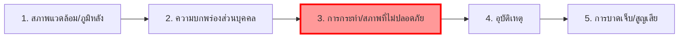

# การป้องกันอุบัติเหตุจากการทำงานและทฤษฎีโดมิโน (Workplace Accident Prevention & Heinrich's Domino Theory)

**วิชา:** OCCUPATIONAL HEALTH AND SAFETY (อาชีวอนามัยและความปลอดภัย)  
**สัปดาห์ที่:** Week 09  
**รหัสนักศึกษา:** 69030037  
**ชื่อ-นามสกุล:** นายฉัตรพิศุทธิ์ เพียรธานี  
**ตอนเรียน:** Section 1  

---

## 1. ความสำคัญของการป้องกันอุบัติเหตุ

อุบัติเหตุจากการทำงานไม่ได้เกิดขึ้นจาก "ความบังเอิญ" หรือ "โชคชะตา" แต่เป็นผลลัพธ์ของปัจจัยที่สามารถชี้บ่ง ประเมิน และป้องกันล่วงหน้าได้เสมอ การป้องกันอุบัติเหตุอย่างมีประสิทธิภาพช่วยรักษาทรัพยากรมนุษย์ ลดความสูญเสียทางเศรษฐกิจ และปฏิบัติตามมาตรฐานกฎหมายความปลอดภัย

---

## 2. ทฤษฎีโดมิโนของไฮนริช (Heinrich's Domino Theory)

H.W. Heinrich ได้อธิบายกลไกการเกิดอุบัติเหตุเปรียบเสมือนตัวโดมิโน 5 ตัวที่เรียงต่อกัน เมื่อตัวแรกเริ่มล้ม จะส่งผลให้ตัวถัดไปล้มตามกันเป็นลูกโซ่ จนเกิดการบาดเจ็บหรือความเสียหายในที่สุด:

1. **โดมิโนตัวที่ 1: สภาพแวดล้อมทางสังคมและภูมิหลัง (Social Environment / Ancestry):** นิสัย ค่านิยม ทัศนคติ และการอบรมเลี้ยงดู
2. **โดมิโนตัวที่ 2: ความบกพร่องของบุคคล (Fault of Person):** ความประมาท ความใจร้อน ความไม่รู้ ความอ่อนล้า หรือสภาพจิตใจ
3. **โดมิโนตัวที่ 3: การกระทำและสภาพการณ์ที่ไม่ปลอดภัย (Unsafe Act & Unsafe Condition):**
   - **Unsafe Act (88%):** การกระทำที่ไม่ปลอดภัย เช่น ไม่สวม PPE, หยอกล้อขณะทำงาน, ลัดขั้นตอน, ใช้เครื่องจักรผิดวิธี
   - **Unsafe Condition (10%):** สภาพการณ์ที่ไม่ปลอดภัย เช่น เครื่องจักรไม่มีการ์ด, แสงสว่างไม่เพียงพอ, พื้นลื่น, สายไฟชำรุด
   - **เหตุสุดวิสัย (2%):** ภัยธรรมชาติ
4. **โดมิโนตัวที่ 4: อุบัติเหตุ (Accident):** เหตุการณ์ที่ไม่พึงประสงค์ เช่น ตกจากที่สูง, ถูกเครื่องจักรหนีบ, วัตถุหล่นทับ
5. **โดมิโนตัวที่ 5: การบาดเจ็บหรือความเสียหาย (Injury / Damage):** แผลฉีกขาด, กระดูกหัก, ทรัพย์สินเสียหาย, ทุพพลภาพ หรือเสียชีวิต

---

## 3. หัวใจสำคัญในการตัดวงจรลูกโซ่อุบัติเหตุ

> 🔑 **กุญแจสำคัญ:** ตามหลักการของ Heinrich หากเรา **"ดึงโดมิโนตัวที่ 3 (Unsafe Act / Unsafe Condition) ออกจากแถว"** แรงส่งจากตัวที่ 1 และ 2 จะไม่สามารถส่งต่อไปยังตัวที่ 4 ได้ ทำให้อุบัติเหตุและการบาดเจ็บ **ไม่เกิดขึ้น 100%**

---

## 4. อัตราส่วนปิรามิดอุบัติเหตุของไฮนริช (Heinrich's Triangle 1:29:300)

จากสถิติการศึกษาของ Heinrich พบว่าในทุก ๆ 330 ครั้งของเหตุการณ์ที่เกิดขึ้น:
- **1 ครั้ง:** อุบัติเหตุรุนแรงจนถึงขั้นเสียชีวิต หรือทุพพลภาพถาวร (Major Injury / Fatality)
- **29 ครั้ง:** อุบัติเหตุที่ทำให้บาดเจ็บเล็กน้อย เสียเวลาทำงาน (Minor Injury)
- **300 ครั้ง:** เหตุการณ์เกือบเกิดอุบัติเหตุ ไม่มีการบาดเจ็บแต่เกือบเกิด (Near-Miss)

**บทเรียนที่นำมาใช้:** การควบคุมความปลอดภัยที่มีประสิทธิภาพต้องไม่รอให้เกิดการบาดเจ็บรุนแรง แต่ต้องจัดการแก้ไขปัญหาตั้งแต่ระดับฐานราก คือการลดพฤติกรรมเสี่ยงและจัดการกับรายงาน **Near-Miss (300 ครั้ง)** ให้หมดสิ้นไป
