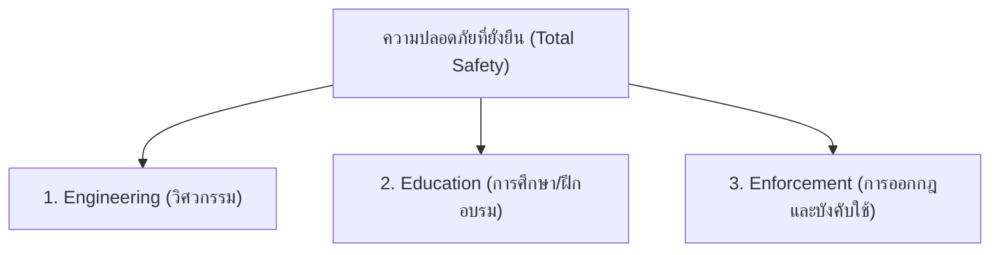

# หลักการ 3E ในการป้องกันอุบัติเหตุ (The 3 Es of Safety)

**วิชา:** OCCUPATIONAL HEALTH AND SAFETY (อาชีวอนามัยและความปลอดภัย)  
**สัปดาห์ที่:** Week 09  
**รหัสนักศึกษา:** 69030037  
**ชื่อ-นามสกุล:** นายฉัตรพิศุทธิ์ เพียรธานี  
**ตอนเรียน:** Section 1  

---

## 1. บทนำและกรอบแนวคิดหลักการ 3E

หลักการ **3E** เป็นหนึ่งในกรอบแนวคิดพื้นฐานคลาสสิกที่พัฒนาโดยสถาบันความปลอดภัยแห่งชาติสหรัฐอเมริกา (National Safety Council - NSC) เพื่อเป็นกลยุทธ์หลักในการลดและขจัดอุบัติเหตุในภาคอุตสาหกรรม โดยเปรียบเสมือนสามเหลี่ยมความปลอดภัยที่ต้องดำเนินการควบคู่กันอย่างสมดุล

---

## 2. รายละเอียดองค์ประกอบทั้ง 3 ด้าน

### 2.1 ด้านวิศวกรรมศาสตร์ (Engineering)
* **นิยาม:** การใช้หลักวิศวกรรมและการออกแบบเพื่อแก้ไขที่ **"สภาพการณ์ที่ไม่ปลอดภัย (Unsafe Condition)"** ที่ต้นตอทางกายภาพ
* **แนวทางปฏิบัติ:**
  - การออกแบบเครื่องจักรให้มีความปลอดภัยในตัวเอง (Inherently Safer Design)
  - การติดตั้งอุปกรณ์ป้องกันอันตรายจากเครื่องจักร (Machine Guarding / Light Curtains)
  - ระบบระบายอากาศเฉพาะที่ (Local Exhaust Ventilation: LEV) กำจัดสารเคมีและฝุ่นละออง
  - การออกแบบสถานีงานตามหลักการยศาสตร์ (Ergonomics Workstation Design) เพื่อลดความเมื่อยล้า
  - การติดตั้งระบบตัดแยกพลังงาน (Lockout / Tagout: LOTO)

### 2.2 ด้านการศึกษาและการฝึกอบรม (Education)
* **นิยาม:** การพัฒนาและสร้างจิตสำนึกเพื่อแก้ไขที่ **"การกระทำที่ไม่ปลอดภัย (Unsafe Act)"** ของคนงาน
* **แนวทางปฏิบัติ:**
  - การปฐมนิเทศความปลอดภัยสำหรับพนักงานใหม่ (Safety Induction)
  - การอบรมขั้นตอนการทำงานที่ถูกต้องและปลอดภัย (Standard Operating Procedures: SOP)
  - การฝึกปฏิบัติกิจกรรมหยั่งรู้ระวังอันตราย (Kiken Yoshi Training: KYT)
  - การฝึกซ้อมแผนฉุกเฉินและดับเพลิง (Emergency Response Drill)
  - การสร้างจิตสำนึกและวัฒนธรรมความปลอดภัยเชิงรุก (Safety Awareness & Proactive Mindset)

### 2.3 ด้านการออกกฎระเบียบและการบังคับใช้ (Enforcement)
* **นิยาม:** การสร้างวินัยและความสม่ำเสมอในการปฏิบัติตามมาตรฐานความปลอดภัย
* **แนวทางปฏิบัติ:**
  - การกำหนดกฎระเบียบและข้อบังคับความปลอดภัยที่ชัดเจน เป็นรูปธรรม
  - การตรวจประเมินความปลอดภัยหน้างานอย่างสม่ำเสมอ (Safety Patrol / Audit)
  - การจัดระบบ Cross-Check ระหว่างหัวหน้างานและเพื่อนร่วมงาน
  - ระบบการให้รางวัลสำหรับพนักงานที่ปฏิบัติตามกฎความปลอดภัย (Safety Incentives) ควบคู่กับมาตรการลงโทษตามขั้นตอนเมื่อมีการฝ่าฝืน

---

## 3. ตารางวิเคราะห์เปรียบเทียบและการบูรณาการ

| หลักการ | เป้าหมายหลัก | วิธีการดำเนินงาน | บทบาทสำคัญ |
| :--- | :--- | :--- | :--- |
| **Engineering** | กำจัดความเสี่ยงที่ตัวเครื่องจักรและพื้นที่ทำงาน | ออกแบบ, ติดตั้งระบบเซนเซอร์, Guarding, ระบายอากาศ | **"Safe Workplace / Safe Machine"** (ทำงานได้อย่างปลอดภัย) |
| **Education** | สร้างความรู้ ความเข้าใจ และทัศนคติ | อบรม, KYT, Toolbox Talk, JSA, ซ้อมแผน | **"Safe Person / Safe Method"** (ทำงานเป็นและคิดอย่างปลอดภัย) |
| **Enforcement** | ควบคุมให้เกิดวินัยและความต่อเนื่อง | Safety Patrol, ตรวจสอบ, ให้รางวัล/ลงโทษ | **"Safe Habit / Safety Discipline"** (ทำงานอย่างปลอดภัยตลอดเวลา) |

> 📌 **สรุป:** หากขาด Engineering สภาพแวดล้อมจะอันตรายตลอดเวลา / หากขาด Education คนงานจะไม่รู้วิธีป้องกัน / หากขาด Enforcement กฎเกณฑ์จะเป็นเพียงกระดาษ ดังนั้นต้องขับเคลื่อนพร้อมกันทั้ง 3 ด้านอย่างต่อเนื่อง
