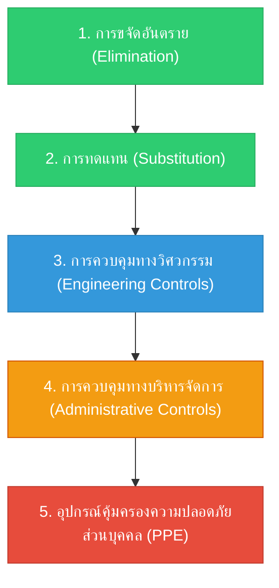
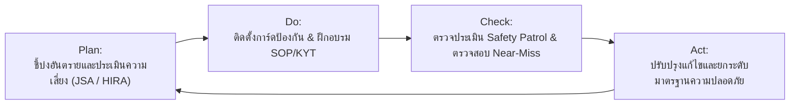

# รูปแบบแนวทางปฏิบัติเพื่อป้องกันอุบัติเหตุ (Accident Prevention Action Patterns)

**วิชา:** OCCUPATIONAL HEALTH AND SAFETY (อาชีวอนามัยและความปลอดภัย)  
**สัปดาห์ที่:** Week 09  
**รหัสนักศึกษา:** 69030037  
**ชื่อ-นามสกุล:** นายฉัตรพิศุทธิ์ เพียรธานี  
**ตอนเรียน:** Section 1  

---

## 1. บทนำและกรอบแนวคิดความร่วมมือ 2 ฝ่าย

ความปลอดภัยในโรงงานอุตสาหกรรมจะสำเร็จได้อย่างยั่งยืน จำเป็นต้องอาศัยการทำงานสอดประสานกันอย่างใกล้ชิดระหว่าง 2 บทบาทหลักในองค์กร:

1. **วิศวกรหรือผู้ออกแบบระบบ (Engineer: E):** ผู้รับผิดชอบด้าน Hardware, โครงสร้างกายภาพ, เครื่องจักร และ Ergonomics
2. **หัวหน้างานหรือเจ้าหน้าที่ความปลอดภัย (Supervisor / Safety Officer: S):** ผู้รับผิดชอบด้าน People, พฤติกรรมการทำงาน, การสอนงาน และการกำกับดูแลวินัย

---

## 2. การประสานบทบาทตามลำดับขั้นการควบคุมอันตราย (Hierarchy of Controls)

### 2.1 หน้าที่ของวิศวกร (Engineering Focus)
* มุ่งเน้นการควบคุมระดับสูง (Top of Hierarchy): **Elimination, Substitution, Engineering Controls**
* ปรับปรุงกระบวนการผลิตเพื่อกำจัดจุดหนีบ จุดตัด (Nip Points & Cutting Hazards)
* ติดตั้งระบบ Interlock เพื่อให้เครื่องหยุดทำงานทันทีเมื่อเปิดฝาครอบ
* คำนวณระบบดูดอากาศและแสงสว่างให้ได้ตามมาตรฐานกฎหมาย

### 2.2 หน้าที่ของหัวหน้างาน/จป. (Human & Process Focus)
* มุ่งเน้นการควบคุมระดับ **Administrative Controls และ PPE**
* ทำการสื่อสารความเสี่ยงหน้างานผ่านกิจกรรม **Toolbox Talk** ทุกเช้าก่อนเริ่มงาน
* จัดทำและทบทวนขั้นตอนการทำงานที่ปลอดภัย (JSA & SOP) ร่วมกับผู้ปฏิบัติงานจริง
* ดูแลความพร้อมของอุปกรณ์ป้องกันอันตรายส่วนบุคคล (PPE Inspection)

---

## 3. วงจรการปฏิบัติงานเชิงรุก (PDCA Cycle in Action Patterns)

---

## 4. ตารางสรุปเปรียบเทียบภารกิจ

| มิติการปฏิบัติงาน | วิศวกร (Engineer) | หัวหน้างาน / จป. (Supervisor / Safety) |
| :--- | :--- | :--- |
| **จุดเน้นหลัก** | สภาพแวดล้อมและระบบกายภาพ (Physical System) | พฤติกรรมและบุคลากร (Human Behavior) |
| **เครื่องมือที่ใช้** | CAD, LOTO, เซนเซอร์, Machine Guarding, LEV | KYT, Toolbox Talk, JSA, Safety Patrol, กฎระเบียบ |
| **เป้าหมายสูงสุด** | **Safe Hardware:** ระบบที่ออกแบบมาให้ผิดพลาดได้ยาก (Foolproof / Poka-Yoke) | **Safe Behavior:** บุคลากรที่มีจิตสำนึกและปฏิบัติตามมาตรฐานอย่างสม่ำเสมอ |

> 💡 **สรุป:** การป้องกันอุบัติเหตุที่มีประสิทธิภาพสูงสุด คือการที่ **"วิศวกรออกแบบระบบให้ปลอดภัยโดยเนื้อแท้"** ควบคู่ไปกับ **"หัวหน้างานที่สร้างทีมงานให้มีวินัยและจิตสำนึกความปลอดภัยอยู่เสมอ"**
